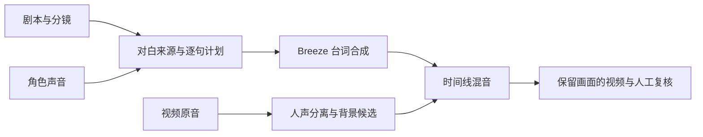

# 台词预合成与视频后期重配

音频后期以运行生成的 `dialogue-source.json` 为对白来源，结合角色声音、分镜时长和视频，创建逐句计划、合成台词并混音。`dialogue_source(run)` 从剧本和分镜确定性投影 segment 编号、文字及对白字符偏移；`panel_index` 从 1 开始，表示 segment 编号，时长可以是小数秒。逐句计划须逐字对齐来源，并核对声线、时间窗口和实际合成时长。

Breeze 参考音用于台词合成，不传入 H3。音频分离器在独立进程中运行，依赖本地模型和配套文件；FFmpeg 用于音轨处理和封装。处理结果需要检查对白时长、音量、背景声、人声残留和口型。人声分离并非无损，混音不能自动保证成片质量。

真实 Breeze 服务、人声分离模型和实际视频尚未完成端到端验证；模拟检查不能证明真实声线、分离质量或音画同步效果。服务配置见[角色声音指南](../guides/character-voices.md)。
