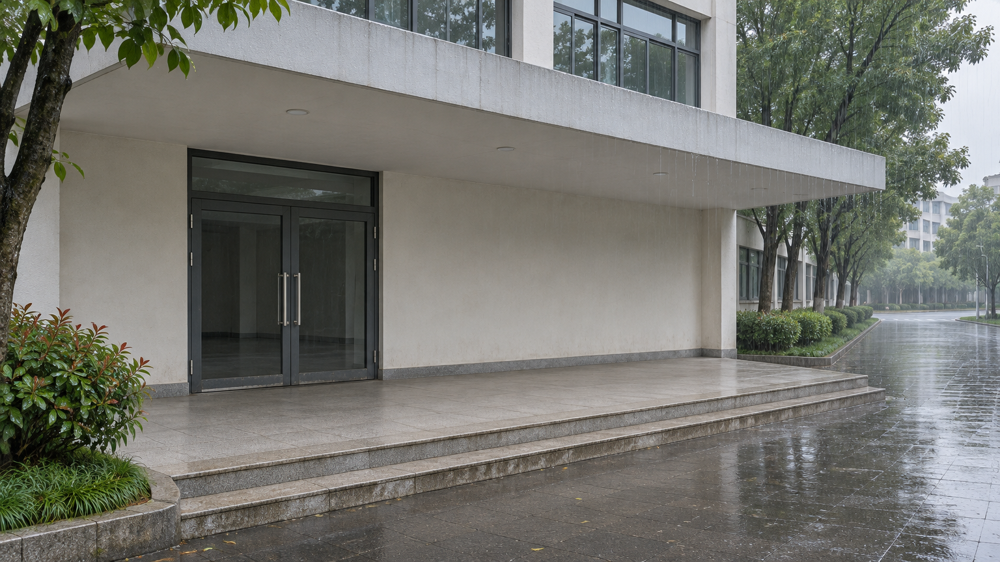

# 《六位玩家》第一世界 · 美术设定集

## 场景清单

| ID | 场景 | 类型 | 出现集 | 锚点 | 光照 | 变体 |
| --- | --- | --- | --- | --- | --- | --- |
| S09 | 学校食堂门口 | 一次性 | 1、3 | 5 | 午后阴雨·屋檐遮雨 | — |

---

## S09 学校食堂门口

用普通校园午后雨檐承载六人吃完饭后的熟络玩笑，干湿交界自然促成聚集与退步，留出由门口到台阶的通路支持结尾一人先走、五人留下。屋檐、双门、地面配色与尺度均为制作设计，不是小说钦定建筑；不增加进屋取物、滑板、群演。



### 一致性锚点

1. **平直浅灰雨檐** — 后方食堂外墙向前挑出的平直浅灰檐板，覆盖连续约7米宽、3米深的干燥平台；仅制作尺度。
2. **深灰双扇玻璃门** — 后方墙面偏左一组深灰金属框双扇玻璃门，门前不设家具；玻璃无人物反射，室内只见暗淡无人的入口，不另建内景。
3. **干湿分界** — 屋檐内浅灰防滑铺地较干，前缘外地面雨湿变深，水滴沿檐口落下形成连续边界；不是积水淹没。
4. **两级宽台阶** — 平台前缘两级宽浅灰台阶下降到校园步道，踏面防滑槽清楚，中央出口与门前通路连通。
5. **右侧开放通路** — 檐下右侧保留空白站立区域，中央出口无桌椅柱体阻挡；台阶外步道向画面右后方延伸，可望见街口方向。

### 光照与时段

- **午后阴雨·屋檐遮雨**：`A single empty exterior of a Chinese campus cafeteria entrance with early 2020s architecture, on a rainy overcast afternoon. Landscape 16:9. Seen from the campus path at a three-quarter angle toward the facade, all five anchors visible: a straight pale grey projecting canopy over a broad sheltered landing; one pair of dark grey metal-framed glass doors set left of center on the rear wall; light grey dry non-slip paving under the canopy meeting darker rain-wet paving at its front drip line; two broad shallow steps descending from the landing to the path; an unobstructed central walking route and generous empty standing space on the right, with the campus path receding to the right toward a distant street corner. The sheltered landing is approximately seven meters wide and three meters deep. No freestanding column obstructs the gathering area. Closed transparent doors show only a dim empty entrance beyond, no separate interior scene. Cool soft afternoon daylight, readable sheltered faces would remain possible, fine rain outside the canopy, restrained wet-ground reflections, no flooding. Plain off-white wall, functional maintained campus finishes, slight foot traffic wear on thresholds and steps. Empty scene, no people, no human reflections, no loose personal belongings, no phones or backpacks, no skateboard, no food, no tables or chairs, no signage or readable text.`

### 出图提示词包

**主视角 EN**

```text
A single empty exterior of a Chinese campus cafeteria entrance with early 2020s architecture, on a rainy overcast afternoon. Landscape 16:9. Seen from the campus path at a three-quarter angle toward the facade, all five anchors visible: a straight pale grey projecting canopy over a broad sheltered landing; one pair of dark grey metal-framed glass doors set left of center on the rear wall; light grey dry non-slip paving under the canopy meeting darker rain-wet paving at its front drip line; two broad shallow steps descending from the landing to the path; an unobstructed central walking route and generous empty standing space on the right, with the campus path receding to the right toward a distant street corner. The sheltered landing is approximately seven meters wide and three meters deep. No freestanding column obstructs the gathering area. Closed transparent doors show only a dim empty entrance beyond, no separate interior scene. Cool soft afternoon daylight, readable sheltered faces would remain possible, fine rain outside the canopy, restrained wet-ground reflections, no flooding. Plain off-white wall, functional maintained campus finishes, slight foot traffic wear on thresholds and steps. Empty scene, no people, no human reflections, no loose personal belongings, no phones or backpacks, no skateboard, no food, no tables or chairs, no signage or readable text.
```

**反向提示词**

```text
people, human figures, characters, crowds, silhouettes of people, human reflections, hands, phones, backpacks, skateboards, food, tables, chairs, blocking pillars, flooding, dramatic night lighting, oversaturated colours, sterile showroom cleanliness, warped perspective, melted geometry, floating objects, text, watermark, signature
```

**设定图 EN**

```text
One 16:9 landscape environment reference sheet. Main master view occupies the upper-left 72 percent width and 70 percent height. Thin dividers separate an L-shaped detail border: two close-up panels on the right and three close-up panels along the bottom. Every detail must be a crop enlargement of the same master space: canopy edge, door frame, dry-to-wet boundary, step grooves, open paving route. Nothing invented that is not present in the master view. THE SPACE MUST BE IDENTICAL ACROSS ALL PANELS. Absolutely no people anywhere. No labels, captions, text or watermarks. A single empty exterior of a Chinese campus cafeteria entrance with early 2020s architecture, on a rainy overcast afternoon. Landscape 16:9. Seen from the campus path at a three-quarter angle toward the facade, all five anchors visible: a straight pale grey projecting canopy over a broad sheltered landing; one pair of dark grey metal-framed glass doors set left of center on the rear wall; light grey dry non-slip paving under the canopy meeting darker rain-wet paving at its front drip line; two broad shallow steps descending from the landing to the path; an unobstructed central walking route and generous empty standing space on the right, with the campus path receding to the right toward a distant street corner. The sheltered landing is approximately seven meters wide and three meters deep. No freestanding column obstructs the gathering area. Closed transparent doors show only a dim empty entrance beyond, no separate interior scene. Cool soft afternoon daylight, readable sheltered faces would remain possible, fine rain outside the canopy, restrained wet-ground reflections, no flooding. Plain off-white wall, functional maintained campus finishes, slight foot traffic wear on thresholds and steps. Empty scene, no people, no human reflections, no loose personal belongings, no phones or backpacks, no skateboard, no food, no tables or chairs, no signage or readable text. Well-kept, actively maintained materials: sound lacquer with an even sheen, swept stone and timber, polished metal fittings, tight joinery, no peeling paint and no water staining; wear confined to the traffic a space like this really takes — thresholds, handrails, the stone directly inside a doorway. Atmospheric depth with haze or volumetric light where the space allows
```

`environment sheet`, `maintained campus`, `rainy afternoon`, `grey paving`, `glass doors`

