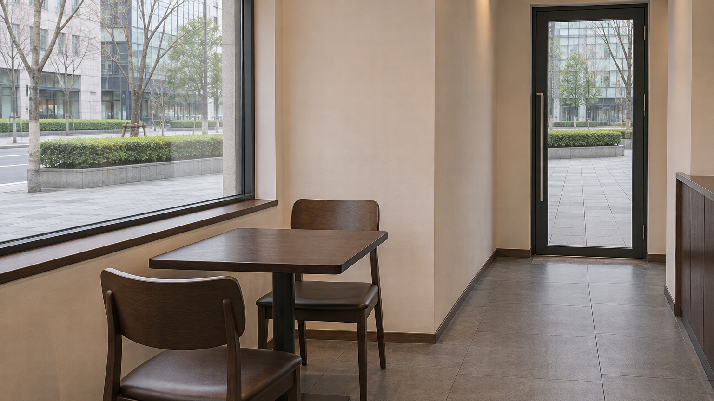

# 《六位玩家》第一世界 · 美术设定集

## 场景清单

| ID | 场景 | 类型 | 出现集 | 锚点 | 光照 | 变体 |
| --- | --- | --- | --- | --- | --- | --- |
| S10 | 咖啡厅 | 一次性 | 1、3 | 5 | 午后阴天·室内临窗桌、同一午后·门外街边 | — |

---

## S10 咖啡厅

以隔桌相对的克制距离承载合作试探与拒绝，再沿可见出口接门外停步与真假提示音反差。室内、玻璃出口、门外街边属于同一咖啡厅连续空间，但不是同一人物坐标。以下窗、桌椅、门和通路形制均为制作设计，不冒称小说钦定。



### 一致性锚点

1. **临窗双人方桌** — 西侧固定窗旁一张深色小方桌，南北两把独立椅，桌南缘用于推黑卡；不加咖啡饮食。
2. **西侧固定玻璃窗** — 桌西侧整块固定玻璃窗，深灰窄框，望见同一街边，无可读标识。
3. **东侧单扇玻璃门** — 室内东南侧单扇深灰框玻璃出口，窄竖把手，连接门外街边，不与西侧固定窗混淆。
4. **桌到门空通路** — 桌东侧保留通往东南出口的连续走路空地，不穿墙、不穿桌。
5. **门外浅灰铺地** — 与门槛外相连的浅灰街边铺地，延续门窗深灰框与同一建筑；门外停步位置距门一小步。

### 光照与时段

- **午后阴天·室内临窗桌**：`Empty contemporary Chinese city cafe in early 2020s architectural style, landscape 16:9, no people. A small dark rectangular table beside a single fixed west-side window has two separate chairs at its north and south sides. A clear walking aisle runs east of the table to a single narrow dark grey metal-framed glass exit at the southeast corner, with a slim vertical handle. The exit is distinct from the fixed window. Beyond its threshold is a light grey paved streetside area. Soft overcast afternoon light through the window, no direct sun. Plain warm off-white walls and maintained dark wood furniture; light traffic wear at the threshold. No drinks, food, personal belongings, cards, phones, readable signs or decorations. The interior table, fixed window, exit and outside paving must remain one consistent architecture, with an unobstructed route from chair to exit.`
- **同一午后·门外街边**：`Empty contemporary Chinese city cafe in early 2020s architectural style, landscape 16:9, no people. A small dark rectangular table beside a single fixed west-side window has two separate chairs at its north and south sides. A clear walking aisle runs east of the table to a single narrow dark grey metal-framed glass exit at the southeast corner, with a slim vertical handle. The exit is distinct from the fixed window. Beyond its threshold is a light grey paved streetside area. Soft overcast afternoon light through the window, no direct sun. Plain warm off-white walls and maintained dark wood furniture; light traffic wear at the threshold. No drinks, food, personal belongings, cards, phones, readable signs or decorations. The interior table, fixed window, exit and outside paving must remain one consistent architecture, with an unobstructed route from chair to exit. View the same exit from the outside streetside at eye level: a close local view of the grey door frame and adjacent paving, with the table remaining inside beyond the doorway; never move the table outside.`

### 出图提示词包

**主视角 EN**

```text
Empty contemporary Chinese city cafe in early 2020s architectural style, landscape 16:9, no people. A small dark rectangular table beside a single fixed west-side window has two separate chairs at its north and south sides. A clear walking aisle runs east of the table to a single narrow dark grey metal-framed glass exit at the southeast corner, with a slim vertical handle. The exit is distinct from the fixed window. Beyond its threshold is a light grey paved streetside area. Soft overcast afternoon light through the window, no direct sun. Plain warm off-white walls and maintained dark wood furniture; light traffic wear at the threshold. No drinks, food, personal belongings, cards, phones, readable signs or decorations. The interior table, fixed window, exit and outside paving must remain one consistent architecture, with an unobstructed route from chair to exit.
```

**反向提示词**

```text
people, human figures, characters, crowds, human reflections, silhouettes of people, phones, cards, coffee cups, food, readable text, watermark, signature, warped perspective, melted geometry, floating objects, blocked exits
```

**设定图 EN**

```text
One 16:9 landscape sheet. Upper-left master view covers 72 percent width and 70 percent height. An L-shaped detail border has two close-up panels at right and three along the bottom, separated by thin lines. Show crop enlargements of table edge, fixed window frame, exit handle, clear aisle and threshold paving; nothing invented that is not present in the master view. THE SPACE MUST BE IDENTICAL ACROSS ALL PANELS. Absolutely no people anywhere. No labels or text. Empty contemporary Chinese city cafe in early 2020s architectural style, landscape 16:9, no people. A small dark rectangular table beside a single fixed west-side window has two separate chairs at its north and south sides. A clear walking aisle runs east of the table to a single narrow dark grey metal-framed glass exit at the southeast corner, with a slim vertical handle. The exit is distinct from the fixed window. Beyond its threshold is a light grey paved streetside area. Soft overcast afternoon light through the window, no direct sun. Plain warm off-white walls and maintained dark wood furniture; light traffic wear at the threshold. No drinks, food, personal belongings, cards, phones, readable signs or decorations. The interior table, fixed window, exit and outside paving must remain one consistent architecture, with an unobstructed route from chair to exit. Well-kept, actively maintained materials: sound lacquer with an even sheen, swept stone and timber, polished metal fittings, tight joinery, no peeling paint and no water staining; wear confined to the traffic a space like this really takes — thresholds, handrails, the stone directly inside a doorway. Atmospheric depth with haze or volumetric light where the space allows
```

`environment sheet`, `maintained cafe`, `overcast afternoon`, `dark wood`, `glass`

