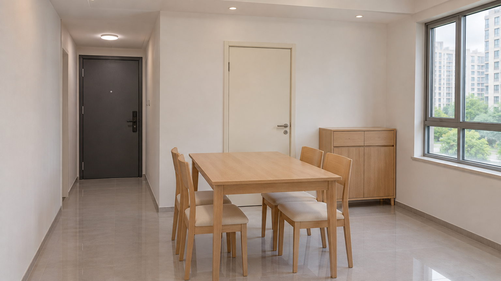

# 《六位玩家》第一世界 · 美术设定集

## 场景清单

| ID | 场景 | 类型 | 出现集 | 锚点 | 光照 | 变体 |
| --- | --- | --- | --- | --- | --- | --- |
| S01 | 黎汐家 | 主场景 | 1、2、3、4 | 5 | 白天·窗侧柔光（制作时段提案） | — |

---

## S01 黎汐家

让迎客的日常亲密与厨房关门的遮蔽形成反差；一眼看懂玄关到生日桌、桌后厨房门的路线。方位、家具与材质均为制作设计，不能据此新增家人、聚会客人或厨房事件。



### 一致性锚点

1. **西侧玄关门** — 住宅西侧深灰入户门，内侧窄玄关，无第二个外门。
2. **中央生日桌** — 室内中央浅木长方桌，西侧通道与玄关连接；有普通椅子但本场不强加坐下动作。
3. **桌后厨房门** — 北墙一扇米白实体厨房门，开口正对桌北侧，可探身、最后关上；不是玄关门。
4. **玄关到桌通路** — 西侧玄关与桌西边之间连续空地，不穿桌也不穿厨房。
5. **东侧窗光** — 东侧固定窗提供柔和日间光，窗框浅灰，窗外不出现人群。

### 光照与时段

- **白天·窗侧柔光（制作时段提案）**：`Empty interior of an early-2020s Chinese city apartment, landscape 16:9, no people. A single dark grey entrance door at the west leads through a narrow foyer into the west side of a central light wood rectangular dining table. Leave a clear continuous aisle between foyer and table. A single cream solid kitchen door on the north wall is directly behind the north side of the table and is clearly distinct from the west entrance door. Ordinary dining chairs remain tucked clear of the west aisle. Soft overcast daylight enters through a fixed east window with a pale grey frame. Plain maintained walls, modest domestic furniture, no party guests, no birthday cake, no food, no cups, no gift, no phone, no television, no medical equipment, no readable signs or decorations. The table and the two different doors must remain in the same positions across angles. Only an empty local kitchen threshold is visible when its door is open; do not invent a separate room scene.`

### 出图提示词包

**主视角 EN**

```text
Empty interior of an early-2020s Chinese city apartment, landscape 16:9, no people. A single dark grey entrance door at the west leads through a narrow foyer into the west side of a central light wood rectangular dining table. Leave a clear continuous aisle between foyer and table. A single cream solid kitchen door on the north wall is directly behind the north side of the table and is clearly distinct from the west entrance door. Ordinary dining chairs remain tucked clear of the west aisle. Soft overcast daylight enters through a fixed east window with a pale grey frame. Plain maintained walls, modest domestic furniture, no party guests, no birthday cake, no food, no cups, no gift, no phone, no television, no medical equipment, no readable signs or decorations. The table and the two different doors must remain in the same positions across angles. Only an empty local kitchen threshold is visible when its door is open; do not invent a separate room scene.
```

**反向提示词**

```text
people, human figures, characters, crowds, human reflections, silhouettes of people, television, medical equipment, cake, food, cups, phones, gift boxes, text, watermark, signature, warped perspective, melted geometry, floating objects
```

**设定图 EN**

```text
One 16:9 landscape environment sheet. Upper-left main view occupies 72 percent width and 70 percent height. An L-shaped detail border has two closeups at right and three below, separated by thin lines. Detail crops show entrance frame, table edge, kitchen door, clear aisle and east window, nothing invented that is not present in the master view. THE SPACE MUST BE IDENTICAL ACROSS ALL PANELS. Absolutely no people anywhere. No labels or text. Empty interior of an early-2020s Chinese city apartment, landscape 16:9, no people. A single dark grey entrance door at the west leads through a narrow foyer into the west side of a central light wood rectangular dining table. Leave a clear continuous aisle between foyer and table. A single cream solid kitchen door on the north wall is directly behind the north side of the table and is clearly distinct from the west entrance door. Ordinary dining chairs remain tucked clear of the west aisle. Soft overcast daylight enters through a fixed east window with a pale grey frame. Plain maintained walls, modest domestic furniture, no party guests, no birthday cake, no food, no cups, no gift, no phone, no television, no medical equipment, no readable signs or decorations. The table and the two different doors must remain in the same positions across angles. Only an empty local kitchen threshold is visible when its door is open; do not invent a separate room scene. Well-kept, actively maintained materials: sound lacquer with an even sheen, swept stone and timber, polished metal fittings, tight joinery, no peeling paint and no water staining; wear confined to the traffic a space like this really takes — thresholds, handrails, the stone directly inside a doorway. Atmospheric depth with haze or volumetric light where the space allows
```

`environment sheet`, `maintained apartment`, `wood table`, `soft daylight`

